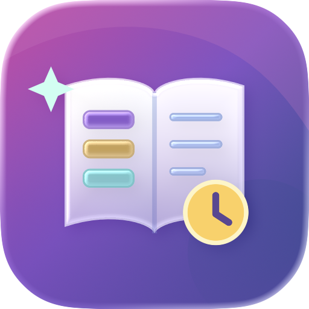
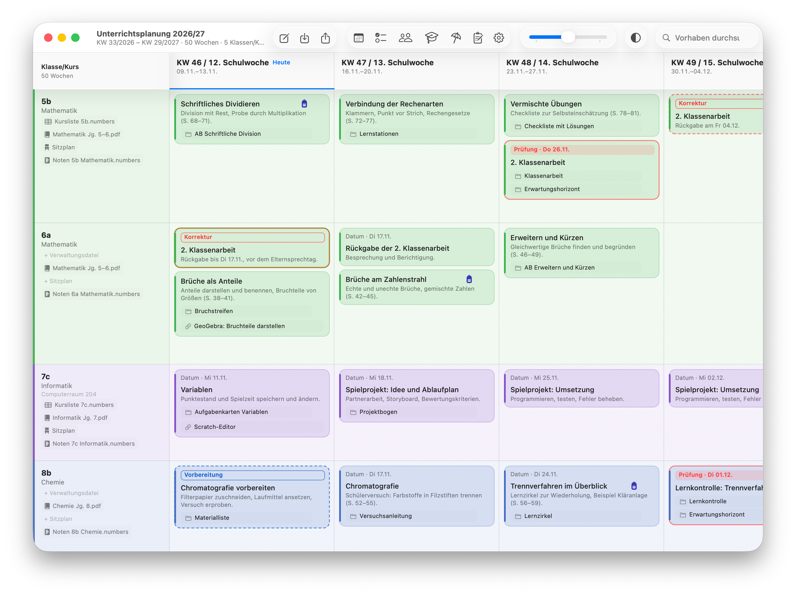
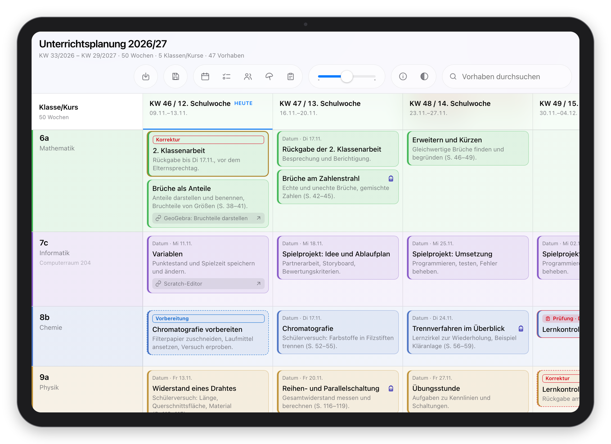
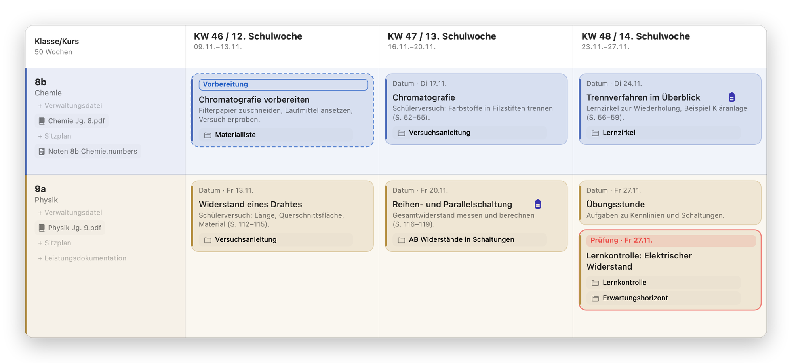
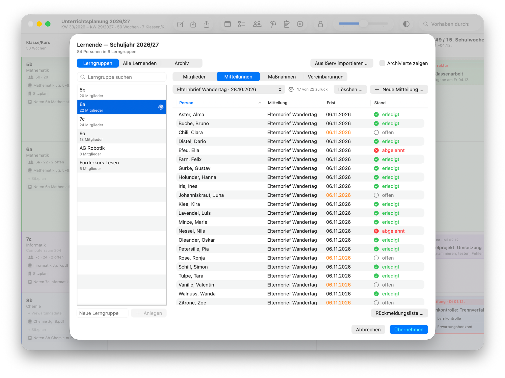
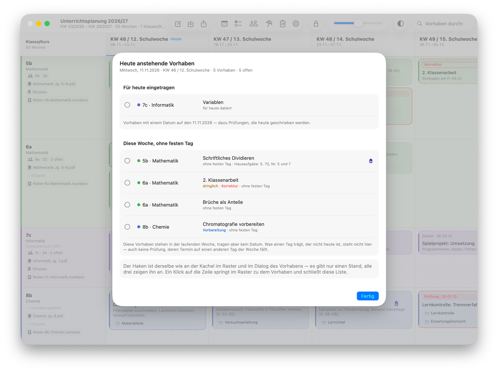
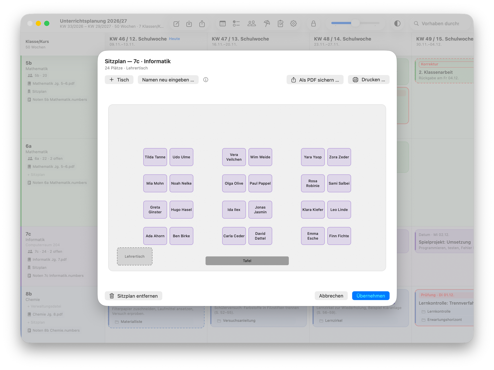

<!--
SPDX-FileCopyrightText: 2026 Dominik Kluge
SPDX-License-Identifier: GPL-3.0-or-later
-->

<h1 align="center">Unterrichtsplanung</h1>

Das ganze Schuljahr auf einen Blick — und zu jeder Stunde das passende Material

· <a href="https://github.com/dk-3du/unterrichtsplanung/releases">Releases</a> ·

---

Ein Schuljahr hat viele Lerngruppen, noch mehr Vorhaben und unzählige Materialien, Links und Notizen. *Unterrichtsplanung*
bringt all das an einen Ort. So ist sofort zu sehen, was diese Woche in der 7c dran ist, wann die nächste Klassenarbeit
ansteht und was noch korrigiert werden muss. Und zu jeder Stunde liegt das Material gleich dabei — ein Klick, und das
Arbeitsblatt ist offen.

  

Das Schuljahr auf einen Blick — und an jeder Stunde das passende Material.

Die App ist für Lehrkräfte gemacht, die ihre Planung selbst in der Hand behalten wollen. Wer möchte, führt darin auch die
eigenen Lerngruppen — mit Mitteilungen wie Elternbriefen samt Rücklauf, vereinbarten Maßnahmen und Gesprächsterminen.
Auf Wunsch kommt eine schlanke Web App fürs iPad hinzu, die die Planung im Unterricht anzeigt; dort wird abgehakt, was
erledigt ist, und eine kurze Notiz zur Stunde wandert zurück an den Mac. Geplant wird in der Mac-App. Die Daten liegen auf
dem eigenen Mac und lassen sich verschlüsseln.

  

Dieselbe Planung auf dem iPad: im Unterricht abhaken und kurz notieren, wie es gelaufen ist.

## Funktionen

- **Das Schuljahr auf einen Blick** — alle Klassen und Kurse über das ganze Jahr in einer Übersicht; Ferien und freie Tage
  sind eingetragen, jedes Fach hat seine Farbe.
- **Stunden und Vorhaben planen** — Klassenarbeiten, Korrekturen, Hausaufgaben und Dringendes fallen sofort ins Auge.
- **Material immer zur Hand** — Arbeitsblätter, Präsentationen, Ordner und Links einfach auf eine Stunde ziehen; ein Klick
  öffnet sie wieder. Auf Wunsch lassen sich auch die Materialien von [3ducation.org](https://3ducation.org) direkt in der
  App auswählen und als Link hinterlegen — zum Abrufen und Verwenden im Unterricht.
- **Jede Klasse mit allem, was dazugehört** — Lehrplan, Notenliste und Sitzplan liegen direkt bei der Klasse.
- **Sitzpläne** entwerfen, ausdrucken oder als PDF weitergeben.
- **Was heute ansteht** — alles für den heutigen Tag in einer Liste zum Abhaken.
- **Lerngruppen im Blick** — Schülerinnen und Schüler aus IServ übernehmen oder von Hand eintragen, Mitteilungen samt
  Rücklauf, Maßnahmen und Termine verfolgen; am Schuljahresende kommt alles ins Archiv.
- **Auf dem iPad im Unterricht** (optional) — eine schlanke Web App zeigt die Planung an; Abgehaktes und Notizen gehen an
  den Mac zurück. Planen und Bearbeiten bleibt der Mac-App vorbehalten.
- **Datenschutz von Anfang an** — die Daten liegen auf dem eigenen Mac und lassen sich verschlüsseln; was für die Web App
  in die eigene, optionale Cloudablage geht, ist stets verschlüsselt. Die Lernendenverwaltung bleibt auf dem Mac; was in
  Titel, Beschreibung oder Kommentar eines Vorhabens steht — auch im Titel eines Termins —, gehört zur Planung und
  erscheint bei Verwendung der Web App auch auf dem iPad.

  

Material immer zur Hand: Arbeitsblätter, Ordner und Links hängen direkt an der Stunde.

  

Lerngruppen im Blick: Wer hat den Elternbrief schon zurückgegeben?

  

Was heute ansteht — als Liste zum Abhaken.

  

Sitzpläne entwerfen, drucken oder als PDF weitergeben.

## Installation

1. Beim [neuesten Release](https://github.com/dk-3du/unterrichtsplanung/releases/latest) die Datei
   `Unterrichtsplanung-….dmg` laden.
2. Die Datei öffnen und *Unterrichtsplanung* in den Ordner „Programme“ ziehen.
3. Die App starten — sie ist von Apple auf Schadsoftware geprüft und beglaubigt; macOS fragt beim ersten Start nur einmal
   nach, ob sie geöffnet werden soll.

Beim ersten Start hilft eine kurze Einrichtung, eine Tour zeigt das Wichtigste. Auf Wunsch meldet die App neue Versionen
selbst; für ein Update genügt es, die neue App über die alte zu ziehen — Planung und Einstellungen bleiben erhalten.

**Web App fürs iPad (optional):** <https://3ducation.org/upapp/> in Safari öffnen und zum Home-Bildschirm hinzufügen. Die
Planung kommt über eine Cloudablage aufs iPad: Auf Wunsch legt die App beim Beenden eine Sicherungsdatei dort ab — stets
verschlüsselt —, und die Web App öffnet sie mit der Passphrase.

Wer die App selbst bauen möchte, findet den Quelltext im Ordner [`macOS-App/v94/`](macOS-App/v94/).

## Voraussetzungen

- Ein Mac mit Apple-Chip (M1 oder neuer) und macOS 26 oder neuer.
- Optional für die Web App: ein iPad mit Safari oder ein anderes Gerät mit aktuellem Browser.
- Für die Lerngruppen muss die Verschlüsselung eingeschaltet sein.

## Lizenz

*Unterrichtsplanung* ist freie Software. Die Mac-App steht unter der GNU General Public License, die Web App unter der GNU
Affero General Public License, jeweils Version 3 oder neuer. Die Lizenztexte liegen in [`LICENSES/`](LICENSES/); welche
Lizenz für welche Datei gilt, steht in [`REUSE.toml`](REUSE.toml). © 2026 Dominik Kluge, erstellt mit Claude Code.

---

**English.** *Unterrichtsplanung* puts a teacher's whole school year in one overview, with the matching worksheets, folders
and links right next to each lesson; materials from 3ducation.org can be picked directly in the app and attached as links.
Optionally, the app also keeps track of student groups, notices such as letters to
parents and their replies, agreed measures and appointments. An optional, slimmer web app shows the plan on the iPad in
class: lessons are checked off there and a short note goes back to the Mac, while all planning happens in the Mac app; the
backup file it reads from a cloud folder is always encrypted. Your data lives on your Mac and can be encrypted. To install, download the disk image from the
[latest release](https://github.com/dk-3du/unterrichtsplanung/releases/latest) — it is checked and notarized by Apple —
and drag the app into Applications; it needs a Mac with Apple silicon and macOS 26 or later. Free software under the
GPL (app) and AGPL (web app), version 3 or later. The app and its documentation are in German.
